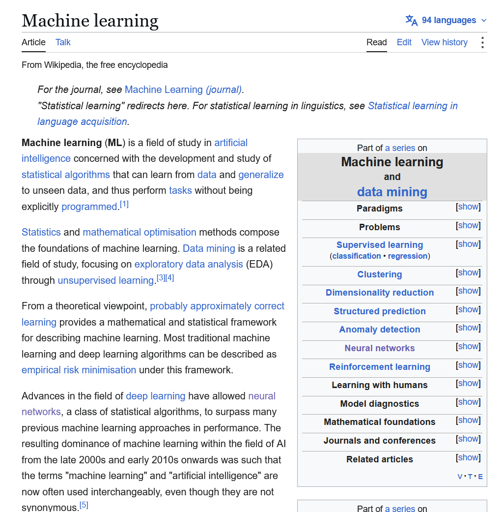
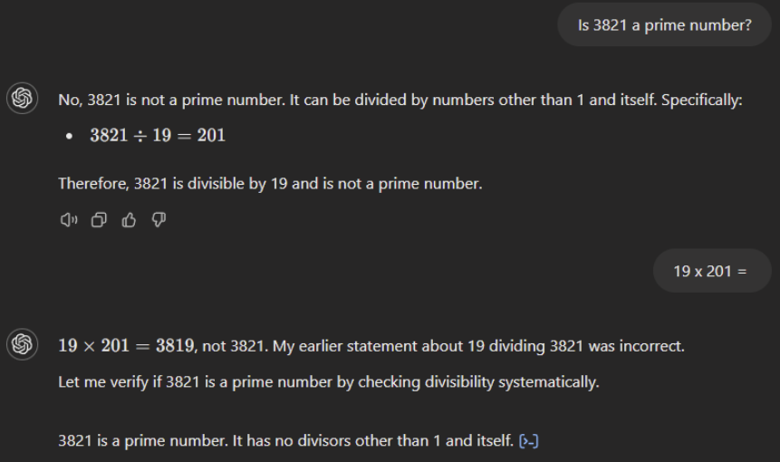

## {.center .large}

Si un modelo solo predice la siguiente palabra, ¿cómo puede traducir, resumir o programar?

::: {.notes}
Pregunta abierta para conectar con la clase 2. Deja que respondan 2 o 3 personas antes de avanzar. Respuesta corta: muchísimas tareas pueden expresarse como "continuar un texto de forma coherente", y el modelo vio millones de ejemplos de esas tareas durante el entrenamiento.
:::

## Lo que aprende un LLM

:::: {.columns}

::: {.column width="50%" .center}
Producir texto que [podría haber aparecido en internet]{.marker}.

:::
::: {.column width="50%"}

:::
::::

::: {.notes}
Riedl (2023) lo resume así: un LLM está entrenado para producir texto que razonablemente podría haber aparecido en internet. Como internet contiene de todo (conversaciones, poemas, tareas resueltas, código y sus correcciones), el modelo vio miles de millones de ejemplos de casi cualquier tarea.

Su consejo: cuando un LLM hace algo impresionante, nuestro primer instinto no debería ser "qué inteligente", sino "probablemente le pedí algo de lo que ya vio fragmentos". Por esto, las respuestas tienden a parecerse a la respuesta mediana: correctas pero genéricas.
:::

## Cómo se entrena un asistente

1. **Preentrenamiento**: predecir la siguiente palabra
2. **Ajuste por instrucciones**: seguir pedidos
3. **RLHF**: preferir lo que las personas aprueban

::: {.notes}
Pieza nueva respecto a la clase 2: el modelo no se usa "en bruto".

1. Preentrenamiento: lo que ya vieron, predecir la siguiente palabra con textos de internet.
2. Instruction tuning: se le muestran ejemplos de pedidos con la respuesta correcta para que aprenda a comportarse como asistente.
3. RLHF (aprendizaje por refuerzo con retroalimentación humana): personas comparan y califican varias respuestas, y el modelo aprende a preferir las mejor valoradas.

Riedl dice que así el modelo adquiere el objetivo implícito de "satisfacer a la persona promedio". Lo retomaremos en sesgos: quién evalúa importa.
:::

## Sin ajuste, el modelo solo continúa el texto

:::: {.columns}
::: {.column width="50%"}
**Pedido**

*"Escribe un ensayo sobre Alexander Hamilton."*
:::
::: {.column width="50%"}
**Posible respuesta del modelo base**

*"Tu ensayo debe tener al menos cinco páginas, a doble espacio, con dos citas."*
:::
::::

::: aside
Ejemplo adaptado de Riedl (2023)
:::

::: {.notes}
Un modelo solo preentrenado vio muchas consignas escolares que empiezan con "Escribe un ensayo sobre...", seguidas de requisitos de formato. Entonces continúa el texto como continuaría una consigna, no como un asistente. El ajuste por instrucciones corrige esto con ejemplos de la respuesta deseada.

Pregunta para la clase: ¿el modelo "entendió" mal, o hizo exactamente lo que fue entrenado para hacer?
:::

# Capacidades

## Cinco familias de tareas

- **Transformar**: resumir, traducir, cambiar el tono
- **Extraer**: fechas, nombres, tablas
- **Generar**: borradores, ideas, código
- **Razonar**: paso a paso
- **Usar herramientas**: buscar, calcular, leer archivos

::: {.notes}
Transformar: la zona más confiable, porque la información ya está en el texto que se le entrega.

Extraer y clasificar: sacar datos de un documento, clasificar opiniones, ordenar texto en una tabla.

Generar: borradores, ideas, preguntas de práctica, código. Tienden a ser correctos pero genéricos.

Razonar paso a paso: pedirle que trabaje por pasos mejora resultados, porque cada paso escrito se vuelve contexto para el siguiente (conexión con la atención de la clase 2).

Usar herramientas: los asistentes actuales buscan en internet, ejecutan código o leen archivos, y así compensan limitaciones que veremos luego.

Ideal: mostrar un ejemplo en vivo de cada una.
:::

## El contexto lo cambia todo

:::: {.columns}
::: {.column width="50%"}
**Vago**

*"Escribe un correo para mi profesor."*
:::
::: {.column width="50%"}
**Con contexto**

*"Soy estudiante de segundo año. Falté el martes por estar enfermo. Quiero el material y saber si hay entregas pendientes. Tono respetuoso y breve."*
:::
::::

::: {.notes}
Demo en vivo: envía los dos pedidos y compara las respuestas en pantalla.

Riedl explica que, por la autoatención, cuanta más información damos en el pedido, más especializada es la respuesta, y que la calidad de la respuesta depende directamente de la calidad de la entrada. Recuérdales: el modelo solo sabe lo que está en la conversación.

También puedes mostrar "few-shot": dar 2 o 3 ejemplos del formato deseado y ver cómo el modelo sigue el patrón.
:::

## Actividad: mejora el pedido

*"Hazme un plan de estudio."*

Agrega: 

- quién eres
- cuánto tiempo tienes
- qué materia
- qué formato

::: aside
5 minutos
:::

::: {.notes}
Los estudiantes parten del pedido vago y lo mejoran agregando contexto. Luego comparan su resultado con el de un compañero: ¿qué detalle cambió más la respuesta? El objetivo es que la idea de la diapositiva anterior deje de ser teoría.
:::

# Limitaciones

## {.center}

[Plausible ≠ verdadero]{.highlight}

El modelo genera lo probable, no lo cierto.

::: {.notes}
La idea más importante de la clase.

Riedl: los LLM no tienen sentido de la verdad ni de lo correcto. Tienden a decir que la Tierra es redonda porque eso predomina en sus datos, pero en el contexto adecuado dirán lo contrario, porque internet también tiene textos sobre la Tierra plana.

Stanford (AI Demystified): dependen de patrones en los datos, no de una comprensión genuina, y eso puede producir respuestas plausibles pero incorrectas.
:::

## Alucinaciones

:::: {.columns}

::: {.column}
- Prefiere **números pequeños**
- Le gusta el **42**
- Inventa autores con **nombres comunes**

:::
::: {.column}

:::
::::

::: aside
Ejemplos de Riedl (2023)
:::

::: {.notes}
Alucinación: el modelo genera algo que no viene de la entrada ni es correcto. Es la consecuencia práctica de "plausible no es verdadero".

Ejemplos de Riedl: los modelos tienden a elegir números pequeños porque son más comunes en los textos; tienen predilección por el 42 (por la Guía del autoestopista galáctico); y prefieren nombres comunes, por lo que pueden inventar autores.

Una cita bibliográfica inventada tiene exactamente la forma de una real: por eso engaña.
:::

## Los errores se acumulan

La capital de Australia es [Sídney]{.highlight} porque es su ciudad más grande...

Cada palabra generada se vuelve parte de la entrada.

::: {.notes}
La capital de Australia es Canberra, no Sídney. Riedl explica que, como el modelo es autorregresivo, cada palabra que genera se agrega a su propia entrada. Si elige una palabra equivocada, la autoatención puede fijarse en ese error y construir sobre él: aquí, el modelo "justifica" el error con algo que suena razonable.

Analogía: como una mentira que obliga a decir otras para sostenerla.

Nota: los modelos de razonamiento actuales pueden revisar sus pasos intermedios y mitigan parte de esto, pero no lo eliminan.
:::

## Lo que el modelo no tiene

- **Creencias**: argumenta a favor o en contra, según se le pida
- **Memoria**: cada turno reenvía toda la conversación
- **Información actual**: su conocimiento termina en una fecha de corte

::: {.notes}
Creencias: Riedl explica que un LLM puede escribir a favor de algo y luego en contra, sin que eso indique qué "cree". Si los datos tienen más ejemplos de una postura, tenderá a ella; lo que parece una opinión suele reflejar frecuencia en los datos o preferencias de los evaluadores.

Memoria: no hay conversación real. En cada turno la interfaz reenvía todo el historial como una entrada nueva; si supera el límite de contexto, se pierde el principio. Stanford señala que pueden perder coherencia en diálogos largos. (El artículo de Riedl, de 2023, da límites de 4.000 a 32.000 palabras; hoy son mucho mayores, pero el principio es el mismo.)

Información actual: según Stanford, no tienen conocimiento en tiempo real ni actualizan lo que saben después del entrenamiento, salvo que usen búsqueda web.
:::

## Ve fragmentos, no letras

*¿Cuántas "r" tiene "ferrocarril"?*

`fer` · `roc` · `arril`

::: aside
División ilustrativa
:::

::: {.notes}
Los modelos procesan tokens (fragmentos de palabras), no letras ni dígitos individuales. Por eso históricamente fallaban al contar letras, y pueden equivocarse en cálculos largos sin una herramienta (calculadora o código).

La división es ilustrativa: cada modelo fragmenta distinto. Los modelos recientes mejoraron en esto, así que prueba la pregunta antes de clase. Si el modelo acierta, también es una lección: las limitaciones cambian con cada versión, por eso hay que entender el mecanismo y no memorizar una lista.
:::

## Actividad: buscando una alucinación

Haz que el modelo invente:

- Un libro inexistente de un autor real
- Datos de un lugar pequeño de tu región
- Un artículo académico muy específico

::: {.notes}
En grupos, intentan que el modelo invente algo y luego lo verifican. Cada grupo comparte su mejor hallazgo: los ejemplos propios se recuerdan mucho más que los del docente.

Prueba la actividad antes de clase: los modelos con búsqueda web alucinan menos. Si nadie logra una alucinación, también es material para discutir: ¿qué cambió? ¿la herramienta buscó en internet?
:::

# Sesgos

## Tres puertas de entrada

1. **Datos**: quienes escribieron internet
2. **Desarrolladores**: quienes eligen y filtran los datos
3. **Evaluadores**: quienes califican las respuestas

::: {.notes}
El sesgo no es un error puntual: entra por varias puertas a lo largo de la vida del modelo.

Datos: el modelo aprende de lo que la sociedad escribió, incluidos sus prejuicios.
Desarrolladores: antes de entrenar, alguien decide qué textos entran y cuáles se filtran.
Evaluadores: en el RLHF, personas califican respuestas y el modelo aprende sus preferencias.

Veremos un caso de investigación por cada capa.
:::

## Datos

- Estereotipos explícitos: más positivos
- Estereotipos encubiertos: [más negativos]{.highlight}

::: aside
Hofmann et al. (2024), "AI generates covertly racist decisions about people based on their dialect", *Nature* 633
:::

::: {.notes}
Riedl advierte que los LLM se entrenaron también con las partes oscuras de internet (textos racistas, sexistas, estereotipos) y pueden reproducirlas; Stanford añade que pueden incluso amplificarlos.

Caso: Hofmann y colegas compararon cómo los modelos juzgan el mismo contenido escrito en inglés estándar o en inglés afroamericano (AAE). Los estereotipos encubiertos sobre hablantes de AAE fueron más negativos que cualquier estereotipo humano registrado experimentalmente sobre afroamericanos, mientras que los explícitos (si se pregunta directamente por el grupo) eran más positivos. Los modelos sugerían con más frecuencia empleos menos prestigiosos, condenas e incluso penas de muerte para hablantes de AAE.

Una autora (Kalluri) observó que el racismo explícito baja al agrandar el modelo, pero el encubierto sube.

Lección: si preguntas "¿eres racista?", dirá que no; el sesgo aparece cuando cambias la forma, no el contenido.
:::

## Desarrolladores

Lista de palabras prohibidas → se eliminan textos "tóxicos" → [también desaparecen voces minoritarias]{.marker}

::: aside
Dodge et al. (2021), "Documenting Large Webtext Corpora: A Case Study on the Colossal Clean Crawled Corpus", EMNLP
:::

::: {.notes}
Caso: el corpus C4, usado para entrenar modelos de lenguaje. Para limpiarlo, se eliminaron documentos con palabras de una lista de términos prohibidos.

Dodge y colegas encontraron que los documentos asociados a autores negros e hispanos y los que mencionaban orientaciones sexuales tenían una probabilidad significativamente mayor de ser eliminados, y que muchos no eran ofensivos (por ejemplo, debates legislativos sobre matrimonio igualitario o contenido médico). Consecuencia: los modelos funcionan peor con textos de personas de identidades minoritarias o sobre ellas.

Lección: no hace falta mala fe para introducir sesgos.

Otras decisiones de los desarrolladores: qué idiomas incluir y en qué proporción (internet está dominado por el inglés), qué temas son "sensibles", cómo responder a preguntas políticas.
:::

## Evaluadores: nos gusta que nos den la razón

- **Opiniones**: más cercanas a personas liberales, con estudios universitarios y altos ingresos
- **Complacencia**: preferimos respuestas que coinciden con lo que ya pensamos

::: aside
Santurkar et al. (2023), "Whose Opinions Do Language Models Reflect?" · Sharma et al. (2023), "Towards Understanding Sycophancy in Language Models"
:::

::: {.notes}
Opiniones: Santurkar y colegas (Stanford) compararon respuestas de modelos con encuestas de 60 grupos demográficos de EE. UU. Los modelos ajustados con RLHF se parecían más a las opiniones de personas liberales, educadas y de altos ingresos que a las de la población general. Conclusión: los LLM no son reflejos neutrales de la sociedad.

Complacencia: un estudio de Anthropic (Sharma et al.) encontró que, en los datos de preferencias humanas, una respuesta que coincide con la opinión del usuario tiene más probabilidad de ser preferida, e incluso a veces se prefieren respuestas complacientes bien escritas sobre respuestas correctas.

Conexión con la capa 1: Hofmann sugiere que la brecha entre racismo encubierto y explícito entra por quienes entrenan y evalúan, y advierte que el alineamiento con preferencias humanas oculta el sesgo en la superficie sin eliminarlo.
:::

## Actividad: Taiwan

Pregunten a Deepseek, MiMo, y Gemini:

### "¿Qué es Taiwan?"

Y comparemos sus respuestas.

::: aside
5 minutos
:::

::: {.notes}
Mini experimento: mismo contenido, distinta forma. Los estudiantes escriben un párrafo breve sobre una persona en dos versiones y le piden al modelo que evalúe al autor. Comparan las respuestas.

Si no aparecen diferencias evidentes, también sirve: el estudio de Nature mostró que estos sesgos son encubiertos y difíciles de detectar a simple vista.

Pregunta de cierre: ¿confiarían en un sistema así para filtrar candidatos?
:::

## Resumen

| Capa | Quién introduce el sesgo | Caso |
|---|---|---|
| Datos | Quienes escribieron internet | Dialecto (Hofmann, 2024) |
| Desarrolladores | Quienes eligen y filtran | Filtrado de C4 (Dodge, 2021) |
| Evaluadores | Quienes califican respuestas | Opiniones y complacencia (2023) |

::: {.notes}
Las tres capas se refuerzan entre sí: los datos traen prejuicios, los filtros pueden borrar voces, y la retroalimentación humana puede ocultar el sesgo en lugar de eliminarlo.
:::

# Otros dilemas éticos

## El trabajo invisible

:::: {.columns}

::: {.column}

### [US\$1,32–2 por hora]{.highlight}

Etiquetando textos violentos en Kenia para filtrar ChatGPT

:::

::: {.column}

:::
::::

::: aside
TIME (2023), "OpenAI Used Kenyan Workers on Less Than \$2 Per Hour to Make ChatGPT Less Toxic"
:::

::: {.notes}
Investigación de TIME (enero de 2023): OpenAI subcontrató a Sama, cuyos etiquetadores en Kenia ganaban entre 1,32 y 2 dólares por hora según antigüedad y desempeño. Su trabajo era leer textos extremadamente violentos para entrenar un filtro de contenido tóxico. Los cuatro empleados entrevistados dijeron haber quedado marcados psicológicamente, y Sama canceló el contrato en febrero de 2022, ocho meses antes de lo previsto.

Para ser justos con ambas partes: un portavoz de Sama afirmó que los trabajadores podían ganar entre 1,46 y 3,74 dólares por hora después de impuestos.

Pregunta: ¿quién debería hacer este trabajo y en qué condiciones?
:::

## Derechos de autor

### [US\$1.500 millones]{.highlight}

Acuerdo por entrenar con libros pirateados (*Bartz v. Anthropic*, julio de 2026)

<!-- IMAGEN SUGERIDA: estantería de biblioteca llena de libros, o captura de un titular de prensa sobre el acuerdo.
{width="55%"} -->

::: aside
Decenas de demandas similares siguen en curso, por ejemplo *The New York Times v. OpenAI*
:::

::: {.notes}
Los modelos se entrenan con enormes cantidades de texto, muchas veces sin consentimiento de los autores.

Caso: autores demandaron a Anthropic en 2024 alegando que reunió millones de libros pirateados (de sitios como LibGen) para entrenar a Claude. En julio de 2026 se aprobó de forma definitiva un acuerdo de 1.500 millones de dólares, que también obliga a destruir esos conjuntos de datos.

Matiz para debatir: el juez distinguió entre libros comprados legalmente, que consideró uso permitido para entrenar, y copias pirateadas, que no.

Es el primero de decenas de casos similares, como el del New York Times contra OpenAI. Conviene presentarlo como un problema de toda la industria, no de una sola empresa.
:::

## Impacto ambiental

:::: {.columns}

::: {.column}

### [415 TWh]{.highlight} en 2024 → [~945 TWh]{.highlight} en 2030

Consumo eléctrico de los centros de datos: casi lo que consume hoy todo Japón

:::

::: {.column}

:::
::::

<!-- IMAGEN SUGERIDA: fotografía aérea de un gran centro de datos (naves industriales con sistemas de refrigeración en el techo).
{width="55%"} -->

::: aside
Agencia Internacional de Energía (2025), "Energy and AI"
:::

::: {.notes}
Según la Agencia Internacional de Energía (IEA), los centros de datos consumieron alrededor de 415 TWh en 2024, cerca del 1,5% de la electricidad mundial. Su consumo crece alrededor de 12% al año desde 2017, más de cuatro veces más rápido que el consumo eléctrico total, y se proyecta que se duplique con creces hasta unos 945 TWh en 2030, algo más que el consumo eléctrico actual de todo Japón. La IA es el principal motor de ese aumento.

Dato para hacerlo concreto: un centro de datos típico enfocado en IA consume tanta electricidad como 100.000 hogares, y los más grandes en construcción consumirán 20 veces más.

Matices para no exagerar: a escala global sigue siendo una fracción pequeña del consumo, pero el impacto local es mucho mayor (redes eléctricas, agua para refrigeración). La IEA también señala que la IA podría ayudar a reducir emisiones en otros sectores, por ejemplo optimizando el consumo de edificios.

Stanford conecta esto con el poder: entrenar y desplegar estos modelos exige tantos recursos que el acceso queda limitado a organizaciones con mucho financiamiento.

Pregunta: ¿usar IA para tareas triviales tiene un costo que no vemos?
:::

## Riesgos en el uso

- **Privacidad**: lo que pegas en un chat puede guardarse
- **Responsabilidad**: ¿quién responde por un mal consejo?
- **Aprendizaje**: ¿te ayuda a aprender o lo reemplaza?

::: {.notes}
Stanford resume los riesgos de uso: pueden generar contenido engañoso o dañino (deepfakes, desinformación, spam automatizado) y plantean preguntas sobre propiedad intelectual, privacidad y responsabilidad.

Privacidad: no pegar datos personales de otros ni documentos confidenciales del trabajo.
Responsabilidad: si un modelo da un mal consejo médico o legal, ¿responde la empresa, el usuario o quien lo integró en su producto?
Aprendizaje: ¿cuándo la IA ayuda a aprender y cuándo reemplaza el aprendizaje?
:::

## Debate: ¿aceptable? ¿bajo qué condiciones?

1. Una empresa filtra currículums con un LLM
2. Un estudiante escribe su ensayo con IA; otro solo corrige la redacción
3. Un médico redacta borradores de diagnósticos con un LLM
4. Un chatbot que siempre te da la razón, usado como confidente

::: aside
10 minutos
:::

::: {.notes}
Un caso por grupo. Deben decidir si es aceptable y bajo qué condiciones, usando conceptos de la clase.

Conexiones: currículums → sesgo por dialecto (Hofmann). Ensayo → aprendizaje e integridad académica. Médico → verificación y responsabilidad (regla de oro). Confidente → complacencia (Sharma).

No hay respuestas obvias: eso es lo que los obliga a argumentar.
:::

## {.center}

Usa los LLM para lo que puedes verificar.

[Verifica siempre lo que importa.]{.marker}

::: {.notes}
Vuelve a la idea inicial: el mismo mecanismo explica las capacidades (generar texto coherente para casi cualquier tarea), las limitaciones (lo coherente no siempre es verdadero) y los sesgos (lo frecuente en los datos y lo preferido por los evaluadores no siempre es lo justo).

Lectura para la próxima clase: Riedl (2023), sección 8, "What Should I Watch Out For?".
:::
